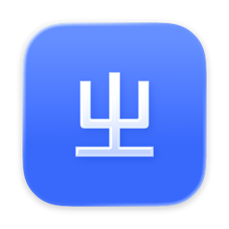
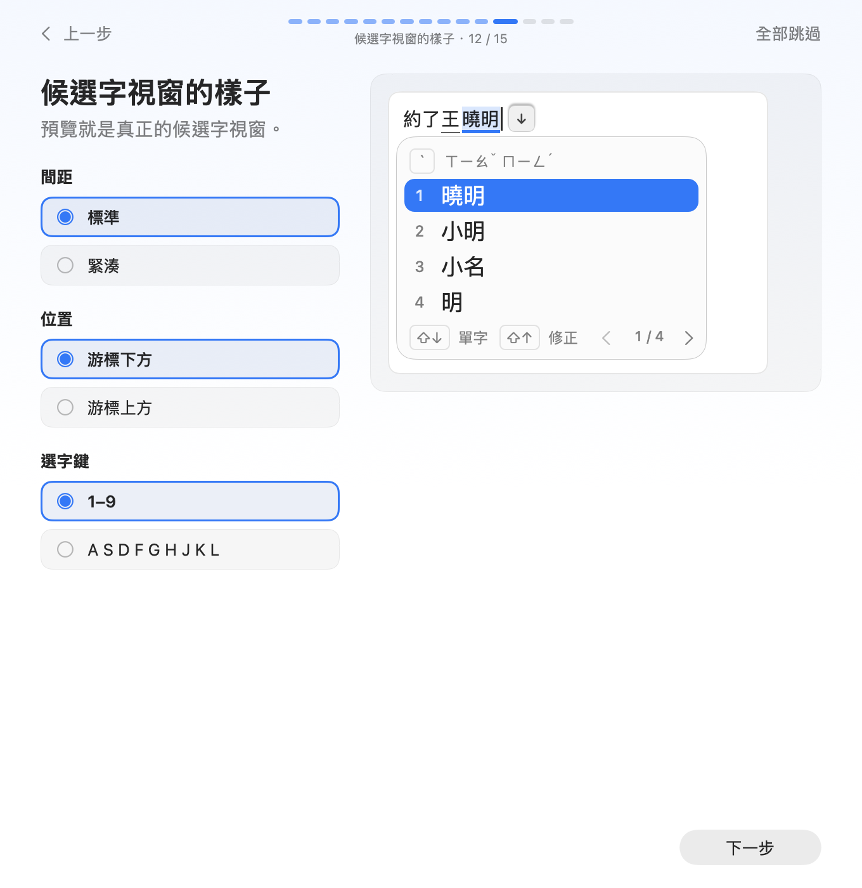
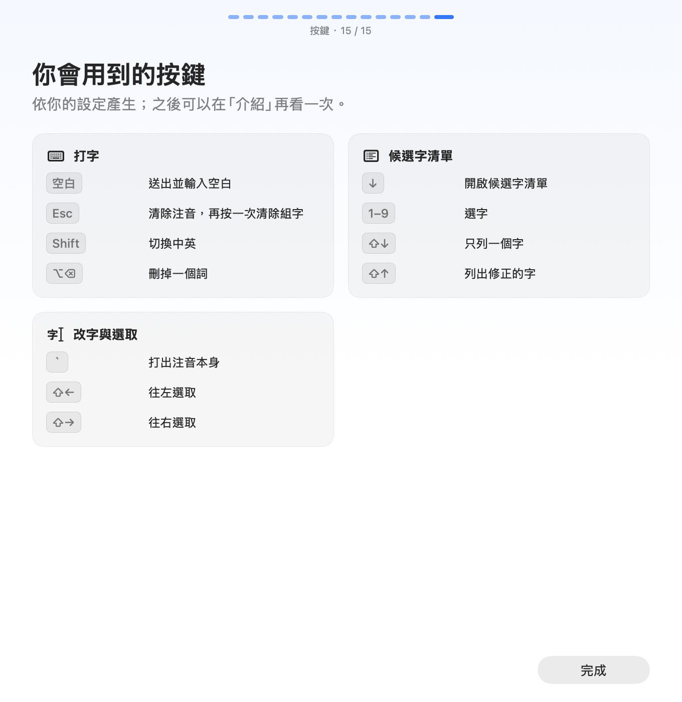

<div align="center">



# ZhuyinType 注音

開源、在本機運作的注音輸入法，支援 macOS、Windows 與 Linux。<br>
整句選字、修正按錯的鍵、依前文調整用語，所有輸入都在這台電腦上處理。

[](https://github.com/henry753951/ZhuyinType/releases/latest/download/ZhuyinType-macOS.pkg)
[](https://github.com/henry753951/ZhuyinType/releases/latest/download/ZhuyinType-Windows-x64-setup.exe)
[](https://github.com/henry753951/ZhuyinType/releases/latest/download/ZhuyinType-Linux-amd64.deb)
[](https://github.com/henry753951/ZhuyinType/releases/latest/download/ZhuyinType-Linux-x86_64.rpm)

[](https://github.com/henry753951/ZhuyinType/releases/latest)
[](https://github.com/henry753951/ZhuyinType/releases)
[](https://github.com/henry753951/ZhuyinType/releases/latest)
[](LICENSE)
<br>
[](https://github.com/henry753951/ZhuyinType/actions/workflows/engine.yml)
[](https://github.com/henry753951/ZhuyinType/actions/workflows/macos.yml)
[](https://github.com/henry753951/ZhuyinType/actions/workflows/desktop.yml)
[](https://github.com/henry753951/ZhuyinType/actions/workflows/ml.yml)
[](docs/benchmarks/)

[下載](#下載) · [系統需求](#系統需求) · [安裝](#安裝) · [移除](#移除) · [發布說明](docs/releases/) · [每版成績](docs/benchmarks/) · [文件](docs/README.md)

</div>

<table>
  <tr>
    <td width="50%"></td>
    <td width="50%"></td>
  </tr>
  <tr>
    <td align="center">第一次使用時，設定嚮導帶你選好打法並試打</td>
    <td align="center">沿用 Windows 或 macOS 注音的按鍵習慣</td>
  </tr>
  <tr>
    <td width="50%"></td>
    <td width="50%"></td>
  </tr>
  <tr>
    <td align="center">調整候選字視窗，預覽即時套用</td>
    <td align="center">依你的設定產生按鍵表</td>
  </tr>
</table>

## 特色

- **整句輸入**：一句話連續打完，依整句的讀音與前後文選出最通順的寫法；一聲可以不按空白。
- **按錯鍵也能打對**：相鄰鍵、多按、漏按、順序打反與聲調打錯都會試著修正，並記住你常按錯的鍵。
- **依前文選字**：參考游標前的文字，聊天時偏向口語，寫文章時偏向書面語。
- **記住你的用法**：選過的字詞與常一起出現的詞會越打越順，也可以新增自訂詞。
- **在本機處理**：選字不連網路，前文只放在記憶體中，密碼欄位裡暫停讀取前文與學習。

## 下載

下方連結固定指向 [最新版本](https://github.com/henry753951/ZhuyinType/releases/latest)；舊版本與檢查碼（`SHA256SUMS-desktop.txt`）在 [所有發布](https://github.com/henry753951/ZhuyinType/releases)。

| 系統 | 下載 | 適用 |
|---|---|---|
| macOS | [ZhuyinType-macOS.pkg](https://github.com/henry753951/ZhuyinType/releases/latest/download/ZhuyinType-macOS.pkg) | macOS 14 以後，Apple 晶片 |
| Windows | [ZhuyinType-Windows-x64-setup.exe](https://github.com/henry753951/ZhuyinType/releases/latest/download/ZhuyinType-Windows-x64-setup.exe) | Windows 10、11（64 位元） |
| Debian、Ubuntu | [ZhuyinType-Linux-amd64.deb](https://github.com/henry753951/ZhuyinType/releases/latest/download/ZhuyinType-Linux-amd64.deb) | Debian 13、Ubuntu 25.04 以後 |
| Fedora、openSUSE | [ZhuyinType-Linux-x86_64.rpm](https://github.com/henry753951/ZhuyinType/releases/latest/download/ZhuyinType-Linux-x86_64.rpm) | Fedora 42 以後、openSUSE Tumbleweed |

## 各系統的支援

三個系統使用同一個引擎與同一份模型；設定頁與設定嚮導的功能、版面一致。macOS 版使用原生外觀，Windows 與 Linux 版共用一套自己的介面。

| | macOS | Windows | Linux |
|---|---|---|---|
| 輸入法架構 | InputMethodKit | TSF（64 與 32 位元的程式都能用） | Fcitx 5 |
| 整句輸入、按錯鍵修正、依前文選字、記住用法 | ✓ | ✓ | ✓ |
| 神經模型（逐字評分、整句重排） | ✓ | ✓ | ✓ |
| 設定、設定嚮導、自訂詞 | ✓ | ✓ | ✓ |
| 候選字視窗 | 原生視窗 | 在打字的程式內繪製，開始功能表搜尋也看得到 | X11 由 ZhuyinType 繪製；Wayland 由 Fcitx 5 顯示 |
| 自動更新 | ✓ | ✓ | ✓ |
| 安裝檔簽章 | 未公證 | 未簽章 | 未簽章 |

## 系統需求

**macOS**

- macOS 14 Sonoma 或更新版本。
- Apple 晶片（M 系列）的 Mac。Intel 處理器的 Mac 目前沒有安裝檔，可從原始碼建置。
- 約 200 MB 的磁碟空間。

**Windows**

- Windows 10 或 Windows 11，64 位元（x64）。ARM 版 Windows 尚不支援。
- 安裝時需要系統管理員權限（一次 UAC 確認）。
- 約 300 MB 的磁碟空間。不需要另外安裝 Visual C++ 執行階段。

**Linux**

- x86_64 的 Debian 13、Ubuntu 25.04、Fedora 42、openSUSE Tumbleweed 或更新版本。
- Fcitx 5（5.1.9 以後）作為輸入法框架，套件會自動安裝。Ubuntu 與 Fedora 的 GNOME 預設使用 IBus，需要先切換到 Fcitx 5（見[安裝](#linux)）。
- 支援 Vulkan 的顯示卡驅動程式（Mesa 即可）。
- 約 300 MB 的磁碟空間。

## 安裝

### macOS

開啟 `ZhuyinType-macOS.pkg`，依指示安裝，需要管理員權限。套件會安裝到 `/Library/Input Methods/ZhuyinType.app`。

第一次使用時：

1. 開啟「系統設定 → 鍵盤 → 輸入方式 → 編輯」（部分版本顯示為「文字輸入」）。
2. 按「＋」，選擇「繁體中文」，加入「ZhuyinType 注音」。
3. 從選單列的輸入法選單選擇「注音 ZhuyinType」，或按 Control-Space 切換（依系統快捷鍵設定）。

清單尚未出現時，請登出再登入。每個帳號各自加入輸入方式。

> [!NOTE]
> App 採 ad-hoc 簽章，pkg 尚未簽署與公證。若 macOS 顯示安全性提示，請至「系統設定 → 隱私權與安全性」選擇仍要開啟。曾從原始碼安裝者，請先移除 `~/Library/Input Methods/ZhuyinType.app`。

### Windows

1. 執行 `ZhuyinType-Windows-x64-setup.exe`，在 UAC 視窗按「是」，依指示完成安裝。
2. 安裝程式會把「ZhuyinType 注音」加入你的輸入法清單，並設定登入時啟動。這台電腦的其他帳號下次登入時也會加入。
3. 按 Win＋空白鍵切換到 ZhuyinType。第一次開啟時，設定嚮導會帶你選好打法並試打。

工作列的輸入指示器顯示「中」或「英」，按一下切換；在上面按右鍵可開啟設定。開始功能表也有「ZhuyinType 設定」。

> [!NOTE]
> 安裝程式尚未簽章，Windows 可能顯示「Windows 已保護您的電腦」。確認檔案是從本專案的發布頁下載後，選擇「其他資訊 → 仍要執行」。

### Linux

```sh
sudo apt install ./ZhuyinType-Linux-amd64.deb        # Debian、Ubuntu
sudo dnf install ./ZhuyinType-Linux-x86_64.rpm       # Fedora
sudo zypper install ./ZhuyinType-Linux-x86_64.rpm    # openSUSE
```

在檔案管理員中按兩下套件檔，也能以軟體中心安裝。相依套件（Fcitx 5、字型、繪圖函式庫）會一併安裝。安裝後：

1. 目前的輸入法框架不是 Fcitx 5 時（例如 GNOME 預設的 IBus），執行 `/usr/lib/zhuyintype/fcitx5-setup framework` 把它設為 Fcitx 5。
2. 登出再登入一次。登入時輸入法服務會在背景啟動，並把 ZhuyinType 加入 Fcitx 5 的輸入方式，原有的輸入方式不變。
3. 以 Fcitx 5 的切換鍵（預設 Ctrl＋空白鍵）切換到 ZhuyinType。從應用程式選單開啟「ZhuyinType 設定」，設定嚮導會帶你選好打法並試打。

## 更新

三個系統都會自動更新：每天檢查一次，有新版本時在你停止打字後安裝，更新檔都經過簽章驗證，設定與個人資料保留。「設定 → 關於 → 更新」可以關閉自動檢查或自動安裝，也可以立即檢查。

- **macOS**：正在使用的輸入法在組字結束後換成新版，不需要登出。
- **Windows**：由安裝時建立的「ZhuyinType 更新」服務安靜安裝，不會跳出 UAC 視窗。正在使用輸入法的程式重新開啟後換成新版，不需要重新開機。
- **Linux**：由套件附的系統服務交給 apt、dnf 或 zypper 安裝，不需要輸入密碼。也可以照常用套件管理員或下載新版套件安裝。

0.6.0 之前的 Windows 與 Linux 開發版沒有自動更新，請手動安裝一次。

## 移除

移除程式時，自訂詞、記住的字詞與設定預設保留，重新安裝後可以繼續使用。要一併刪除的位置列在各系統之後。

### macOS

1. 先切換到其他輸入方式，並在「系統設定 → 鍵盤 → 輸入方式」選取 ZhuyinType，按「－」移除。
2. 在終端機執行：

   ```sh
   sudo rm -rf "/Library/Input Methods/ZhuyinType.app"
   sudo pkgutil --forget org.zhuyintype.pkg
   ```

3. 登出再登入。

個人資料：`~/Library/Application Support/ZhuyinType`，設定可用 `defaults delete org.zhuyintype.inputmethod.ZhuyinType` 刪除。從原始碼安裝者可執行 `platforms/macos/scripts/uninstall.sh`（加上 `--purge` 會一併刪除個人資料）。

### Windows

「設定 → 應用程式 → 已安裝的應用程式 → ZhuyinType 注音輸入法 → 解除安裝」。解除安裝程式會移除輸入法、登入啟動、捷徑與登錄項目，並刪除程式；在「選取元件」頁勾選「同時刪除我的自訂詞、學習記錄與設定」可一併刪除個人資料。仍被其他程式載入的檔案會在下次開機時刪除。

也可以用指令安靜解除安裝：

```bat
"C:\Program Files\ZhuyinType\uninstall.exe" /S
```

個人資料：`%APPDATA%\ZhuyinType`（設定）與 `%LOCALAPPDATA%\ZhuyinType`（自訂詞、學習記錄、使用統計）。

### Linux

```sh
sudo apt remove zhuyintype      # Debian、Ubuntu；apt purge 會一併刪除登入啟動設定
sudo dnf remove zhuyintype      # Fedora
sudo zypper remove zhuyintype   # openSUSE
```

移除後在 Fcitx 5 設定中刪除 ZhuyinType 輸入方式。個人資料：`~/.config/zhuyintype`（設定）與 `~/.local/share/zhuyintype`（自訂詞、學習記錄、使用統計）。

## 基本按鍵

以下為預設設定；完整的按鍵表見 [產品設計 §2.1](docs/product/DESIGN.md#21-組字與按鍵)，「設定 → 快捷鍵」可重新指定。

| 按鍵 | 操作 |
|---|---|
| 注音鍵、聲調鍵（6 3 4 7） | 輸入注音與聲調，連續輸入整句；空白是一聲 |
| 空白 | 打完注音後送出整段並輸入空白（可在設定改成開啟候選字清單） |
| ↓ | 開啟候選字清單；清單開著時，空白翻下一頁 |
| 1–9 | 選取候選字 |
| ↑ ↓ | 在清單裡移動 |
| ← → | 在組字中移動游標；直式清單開著時改前一個或後一個字 |
| ⇧↓／⇧↑ | 清單只列單字／列出按錯修正與模糊音 |
| Return | 送出整段；清單開著時選取目前的候選字 |
| ⌫ | 刪掉一個注音符號或游標前的字；清單開著時先關閉清單 |
| Esc | 關閉清單；再按清除注音，再按清空組字 |
| 單按 Shift | 中英切換 |
| ⇧ 空白（macOS） | 切換中文標點的全形／半形；中文預設全形，英數與空白維持半形 |
| ⌥ 空白（macOS） | 在組字中插入半形空白 |

## 功能

<details>
<summary>展開完整的功能說明</summary>

#### 整句輸入

- 一句話連續打完，不必逐字選字。ZhuyinType 依整句的讀音與前後文選出最通順的寫法，打字時即時更新。
- 一聲可以不按空白：音節已完整、下一鍵是聲母時，自動在這裡斷開。
- 「一」「不」照實際發音打變調也能選對，例如「一定」打 ㄧˊ ㄉㄧㄥˋ、「不要」打 ㄅㄨˊ ㄧㄠˋ。
- 多音字依台灣讀音計分，例如「說」打 ㄕㄨㄟˋ 時「睡」排在前面。
- 「台」與「臺」可在設定擇一，候選字清單把兩種寫法合併成一項。

#### 按錯鍵也能打對

- 按到相鄰的鍵、多按一鍵、漏按一鍵、兩鍵順序打反，ZhuyinType 會試著修正，修正後的結果要明顯比照打的通順才會採用，打對的鍵優先。
- 會參考按鍵的時間：35 毫秒內幾乎同時按下的兩鍵，比較可能是順序打反或誤觸。
- 聲調打錯（三聲與四聲、二聲與輕聲）時一樣找得到想打的字。
- 模糊音可在設定個別開啟：ㄗ／ㄓ、ㄘ／ㄔ、ㄙ／ㄕ、ㄣ／ㄥ、ㄢ／ㄤ。
- 「設定」的「按錯鍵修正」可選關閉、標準或積極。
- 從候選字清單選了修正過的字時，ZhuyinType 會記住你把哪個鍵按成哪個鍵，下次同樣的錯誤更容易修正。

#### 依前文選字

- 開始組字時，讀取游標前最多 128 個字作為前文，選字時參考。
- 依前文自動調整用語：前面是聊天，偏向口語；前面是文章，偏向書面語。
- 接續剛送出的字：一句話分幾次送出時，後面的部分仍接著前面選字。
- App 不提供游標前的文字時，改用你在同一個 App 裡 10 分鐘內送出的字，換輸入框也接得上。
- 前文只放在記憶體中，不寫入磁碟。可在設定關閉；在密碼欄位中一律不讀取。

#### 候選字與改字

- ↓ 開啟候選字清單，長詞在前、單字在後，同一長度依前文排序。空白鍵預設送出並輸入空白，也可改成在組字中輸入空白（不送出）或開啟候選字視窗；清單開著時，空白翻頁。
- ⇧↓ 只列單字，⇧↑ 列出按錯修正與模糊音的字。
- 選字後，其他已顯示的字保持不變；選到詞中間的字時，同一個詞在它前面的字也不變。
- 候選字視窗可調整排列（橫式、直式）、字級、每頁的候選字數、選字鍵、間距、位置（游標下方或上方）、外觀與動畫，設定頁的預覽會即時播放打字的過程。

#### 記住你的用法

- 選過的字詞，下次打同樣的讀音時直接採用。
- 常一起出現的詞會越來越順：個人的一、二、三連詞統計分成短期（約一天內）與長期（約幾個月）兩層。
- 選過的詞在同樣的位置不會被神經模型換掉。
- 送出後 30 秒內用 Backspace 刪掉重打成不同的字，視同改字：新的寫法被記住，舊的減弱。
- 可新增自訂詞，把個別字詞設為不記住，並匯出、匯入、清除個人資料。
- 在密碼欄位中暫停學習。

#### 其他

- 標點按法可在設定選擇：
  - Windows（預設）：Shift 加符號鍵沿用鍵面符號，Control 加符號鍵打出中文標點（Control 加逗號是「，」）。macOS 版預設輸出全形，例如「＜」「＿」，可用 Shift 加空白切換為半形。
  - macOS：和 macOS 內建注音相同，Shift 加符號鍵打出中文標點（Shift 加逗號是「，」）。
- `[` `]` 打出「」，`'` 打出「、」。在標點上按 ↓ 可以換成同類的全形或半形標點。
- 單按 Shift 切換中英文，Caps Lock 開啟時輸入英文。快捷鍵可重新指定。
- macOS 的中文標點預設全形，Shift 加空白切換全形／半形。英文模式的字母、數字、標點與空白都是半形。
- 有新版本時在你停止打字後自動更新，更新檔都經過簽章驗證，正在使用的輸入法在組字結束後換成新版。
- 設定的「分析」頁回顧打了多少字、改了幾次字，以及輸入法每個按鍵的反應時間；只記錄次數與時間，存在這台電腦，可以關閉或清除。
- 不常用的按鍵功能（打出注音本身、單字與修正清單、⌃ 與 ⌥ 的符號、Caps Lock 打英文等）可以個別關閉，按鍵交給 App；每個功能最多可以指定三個按鍵。
- 所有輸入都在本機處理，不連網路選字。

</details>

## 運作方式

每按一個鍵，ZhuyinType 依序經過以下幾層，通常在 20 毫秒左右更新畫面。完整流程見 [架構與流程](docs/engine/ARCHITECTURE.md)，各層的方法與評測數字見 [模型與演算法](docs/engine/MODEL.md)。

```text
按鍵 → ① 切音節 → ② 讀音與容錯 → ③ 整句解碼 → ④ 整句重排 → 畫面
                                     ↑                 ↑
                         前文、個人記憶、逐字模型        前文
```

1. 切音節：把連續的按鍵切成音節，同時處理一聲不按空白、跨音節的順序錯亂與多按的鍵（KeyDecoder，以按鍵位置做 Viterbi 搜尋，並參考按鍵時間）。
2. 讀音與容錯：每個音節找出可能的讀音。照打的讀音不扣分；相鄰鍵、多按、漏按、對調、聲調與模糊音各有扣分，並依你的按錯習慣調降（KeyChannel）。
3. 整句解碼：在所有可能的詞組成的詞圖上，找出分數最高的前 16 個整句。分數包含詞的語言模型機率（聊天與百科兩個模型依前文混合，再依個人統計調整）、讀音機率、容錯扣分，以及逐字模型（v3）依前文與整句讀音給每個字的分數。
4. 整句重排：引擎對首選沒有把握時，字級 Transformer 語言模型（v2b）依前文為前 16 句評分，選出最後顯示的整句。你選過的詞會保留。
5. 送出與學習：送出後更新個人統計與記住的字詞；選了修正過的字時，記下按錯的鍵。

詞庫與語言模型以 mmap 載入，常駐記憶體約 29 MB。兩個神經模型在 CPU 上執行：macOS 使用 Core ML，Windows 與 Linux 使用 ONNX Runtime（同一份權重的動態 int8，結果和 macOS 略有不同，見 [Linux 與 Windows 版](docs/product/DESKTOP.md#神經模型)）。模型檔以 memory-map 讀取，不佔用輸入法自己的記憶體。

## 準確率

每次發布後，CI 會在同一套評測（ZhuyinBench）上測量整句全對率。以下為 [0.4.4 的結果](docs/benchmarks/v0.4.4.md)，沒有前文、每組最多 400 段，括號內把「台／臺」等寫法視為相同：

| 測試集 | 整句全對率 |
|---|---|
| 維基 | 82.8% |
| 口語 | 84.0% |
| 日常短句 | 100.0% |
| Taiwan Tongues | 73.8%（85.0%） |

前文、按錯鍵與候選字排序的結果，以及其他版本，見 [每版成績](docs/benchmarks/)；和其他注音輸入法在相同條件下的比較見 [這份文件](docs/benchmarks/competition.md)。

## 從原始碼建置

需要 [Rust](https://rustup.rs)（引擎；`engine/rust-toolchain.toml` 固定版本）與 [uv](https://docs.astral.sh/uv/)。所有平台共用的工作由根目錄的 `tools/zt` 執行，`tools/zt help` 列出全部指令。

```sh
tools/zt setup           # 檢查並準備開發環境
tools/zt data fetch      # 下載詞庫、語言模型與神經模型（依 resources/assets.json 驗證雜湊）
tools/zt check engine    # 引擎的測試（cargo test --release）
```

各平台的輸入法建置方式：

- **macOS**：需要 Xcode（設定視窗使用 SwiftUI，需要 Xcode 內附的 macro 外掛；本專案使用 Swift 6.4）。`xcode-select -p` 指向 Command Line Tools 時，建置腳本會自動改用 `/Applications/Xcode.app`。

  ```sh
  tools/zt build app       # dist/ZhuyinType.app
  tools/zt build install   # 安裝到目前帳號；正在使用的輸入法會在組字結束後換成新版
  tools/zt build pkg       # dist/ZhuyinType-<版本>.pkg
  ```

- **Windows 與 Linux**：共用 `platforms/desktop/` 的 GPUI 程式，在 GPU 主機上建置（Windows 版交叉編譯），產生 Windows 安裝程式與 `.deb`／`.rpm`，見 [Linux 與 Windows 版](docs/product/DESKTOP.md)。

  ```sh
  tools/zt --remote --pull dist/desktop build desktop --package
  ```

| 目錄 | 內容 |
|---|---|
| `engine/` | 所有平台共用的輸入法引擎（Rust）：組字、按鍵解碼、容錯、語言模型、神經模型、C 介面、`zhuyin-cli` |
| `platforms/desktop/` | Windows 與 Linux 共用的 GPUI 程式（Rust）：設定視窗、候選字視窗、設定嚮導、輸入法服務、Windows 的 TSF 文字服務，以及安裝檔的打包 |
| `platforms/macos/` | macOS 輸入法（InputMethodKit）與建置、發布腳本 |
| `platforms/linux/` | Linux 輸入法（Fcitx 5 附加元件）與測試 |
| `ml/` | 研發：資料、訓練、評測與 `zt` 指令（Python，見 [ml/README.md](ml/README.md)） |
| `resources/` | 資料與模型的固定版本、來源與授權、二進位格式 |
| `tools/` | `zt` 啟動器，說明見 [tools/README.md](tools/README.md) |
| `docs/` | 產品設計、引擎架構與模型、評測、規劃、研究、每版成績、發布說明（[文件地圖](docs/README.md)） |

給 AI 代理與貢獻者的說明在 [AGENTS.md](AGENTS.md)。

## 文件

| 文件 | 內容 |
|---|---|
| [產品設計](docs/product/DESIGN.md) | 按鍵、狀態、預設值、介面 |
| [架構與流程](docs/engine/ARCHITECTURE.md) | 從按鍵到畫面的完整流程與分數公式 |
| [模型與演算法](docs/engine/MODEL.md) | 詞庫、按鍵解碼、容錯、語言模型、神經模型、個人模型與評測數字 |
| [v3 模型設計](docs/engine/MODEL_V3.md) | 按鍵層級解碼器與音節對字模型的設計與實驗紀錄 |
| [評測](docs/ml/EVALUATION.md) | 資料集、評測工具與指令 |
| [規劃](docs/ROADMAP.md) | 開發階段、下一步與待決事項 |
| [研究](docs/research/) | 研究紀錄、相關工作與比較、研究計畫 |
| [每版成績](docs/benchmarks/) | 每個版本在同一套評測（ZhuyinBench）上的結果 |
| [訓練](ml/src/zhuyintype_ml/training/README.md) | 各模型的訓練流程與產物 |
| [文案準則](docs/product/WRITING.md) | 介面與文件用語 |

## 資料與授權

程式碼採 [GNU AGPL 3.0 授權](LICENSE)（`AGPL-3.0-only`），作者為 [Henry753951](https://github.com/henry753951) 與 ZhuyinType 貢獻者。再散布時須保留適用的著作權與授權聲明，並依條款提供對應原始碼；修改後透過網路提供互動服務時，亦須依條款向使用者提供對應原始碼。AGPL 允許商業使用。

著作權與授權聲明見 [NOTICE](NOTICE)。產生的詞庫採 CC BY-SA 4.0。
詞庫使用 CC-CEDICT、Unicode Unihan 與 wordfreq；語言模型與神經模型另外使用維基百科、立法院公報、維基百科討論頁、Common Voice 與 Qwen3-8B 產生的句子。來源、處理方式與署名見 [資料來源](resources/SOURCES.md) 及 [授權文字](platforms/macos/Resources/Licenses)。
發布修改過的詞庫或模型時，請保留來源、修改說明與各自的授權。
