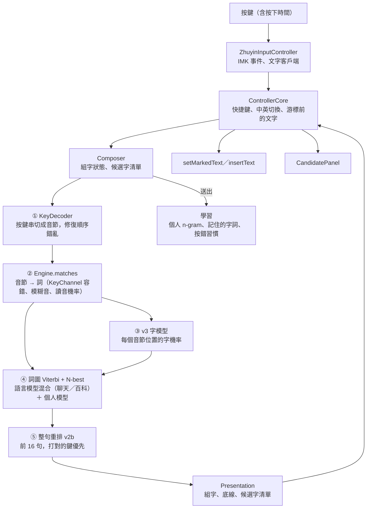
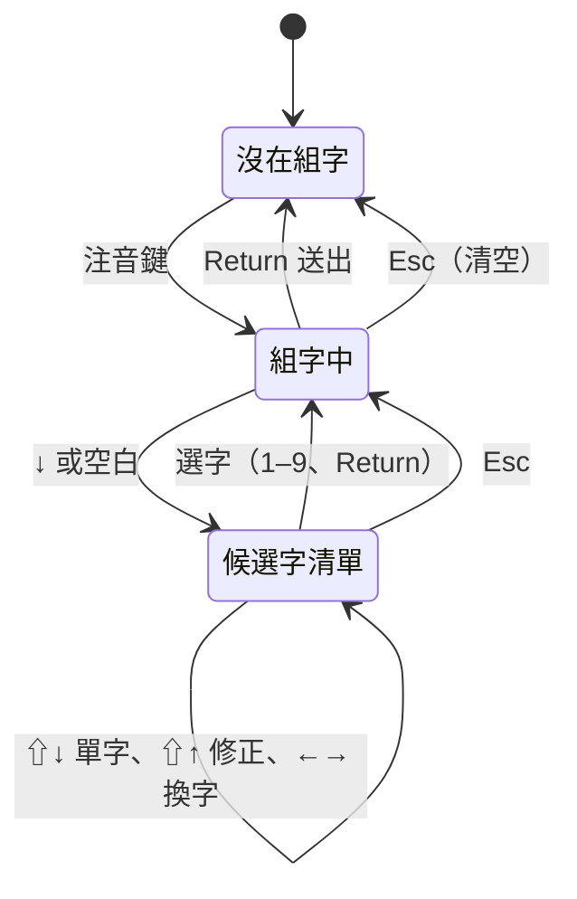
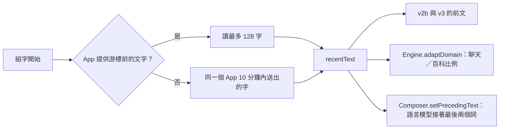
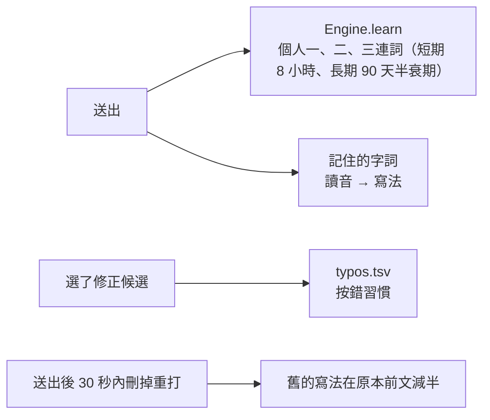
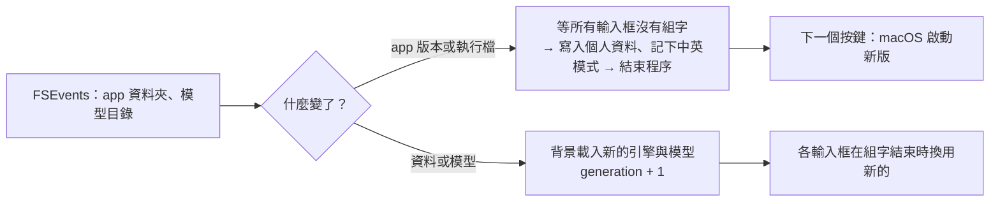
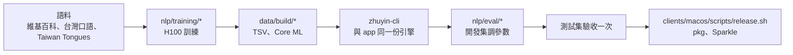

# ZhuyinType 架構與流程

本文件描述目前程式實際的運作方式：從按下一個鍵，到畫面上出現整句、打開候選字清單、送出與學習。各元件的演算法、參數與評測數字見 [MODEL.md](MODEL.md)，使用者看到的操作見 [DESIGN.md](DESIGN.md)，後續規劃見 [ROADMAP.md](ROADMAP.md)。

## 1. 總覽



所有元件在同一個行程內直接呼叫；模型都在 CPU 上同步執行，每鍵在主執行緒完成（延遲見 §7）。

## 2. 程式模組

| 模組 | 位置 | 負責 |
|---|---|---|
| IMK 層 | `clients/macos/Sources/ZhuyinTypeApp/IMK/` | `ZhuyinInputController` 接 IMK 事件；`ControllerCore` 處理快捷鍵、中英切換、前文；`EngineHost` 在背景載入引擎與模型 |
| 介面 | `clients/macos/Sources/ZhuyinTypeApp/UI/` | 候選字視窗（`CandidatePanel`）、設定視窗（`Settings/`） |
| 共用設定 | `clients/macos/Sources/ZhuyinTypeApp/Shared/` | `Preferences`、`Shortcuts`（可重新指定的快捷鍵） |
| 核心 | `nlp/engine/Sources/ZhuyinCore/` | `Composer`（狀態機）、`KeyDecoder`、`KeyChannel`、`Engine`（詞庫、比對、學習）、`Conversion`（詞圖解碼）、`LanguageModel`（bigram、混合、個人模型） |
| 神經模型 | `nlp/engine/Sources/ZhuyinML/` | `NeuralReranker`（v2b 整句重排）、`SyllableScorer`（v3 前文編碼器＋音節對字編碼器） |
| 命令列 | `nlp/engine/Sources/zhuyin-cli/` | 與 app 相同的引擎；評測、參數掃描、模型一致性檢查 |
| 檢查 | `nlp/engine/Sources/ZhuyinCoreChecks/` | 核心行為與延遲檢查（`make checks`） |

## 3. 逐鍵流程

1. **事件**：`ZhuyinInputController.handle` 收到 `NSEvent`，轉成 `KeyInput`（注音鍵、聲調、空白、方向鍵、`.printed` 等），連同 `NSEvent.timestamp` 交給 `ControllerCore.keyDown`。
2. **快捷鍵與模式**：`ControllerCore` 先比對使用者的快捷鍵表（`ShortcutCommand`），再處理中英切換、Caps Lock；組字開始時讀取游標前的文字（§5）。
3. **組字**：`Composer.handle(_:at:)`。注音鍵與聲調鍵放進「按鍵串」（run），其他鍵（方向鍵、選字鍵、Return）依狀態處理。
4. **① 切音節**：`KeyDecoder.decode` 以 Viterbi 搜尋按鍵串的切法（細節見 [MODEL.md §3](MODEL.md#3-按鍵層級解碼器keydecoder)），取成本最低、而且結構相同時由語言模型挑最通順的切法（成本差 6 分以內最多比 6 種）。超過 48 鍵的按鍵串，前面的部分固定下來，不再重切。
5. **② 比對**：每個音節（含按下的鍵）交給 `Engine.matches`：完全符合的讀音、聲調容錯、KeyChannel 修正（相鄰鍵、多按、漏按、對調）與模糊音，各自帶扣分；詞條帶有讀音機率 log P(讀音 | 詞)。
6. **③ 字分數**（有 v3 模型時）：`Composer.scoreCharacters` 收集每個音節位置可能的字（依詞庫分數取前 64 個），連同注音、聲調、修正成本分桶交給 `SyllableScorer`，得到 log P(字 | 所有音節, 前文)。
7. **④ 解碼**：`Conversion` 在詞圖上做 Viterbi 與 N-best。每條邊的分數：

   ```
   邊分數 = log P_LM(詞 | 前一個詞)            聊天與百科的混合，再經個人模型調整
          + log P(讀音 | 詞)                   讀音機率
          − 容錯扣分                           KeyChannel、聲調、模糊音
          + 自訂詞與記住的字詞加分
          + w_v3 × Σ log P_v3(字 | 音節, 前文)  有 v3 模型時
   句尾   + log(s · P(</s> | 最後的詞) + 1 − s)   s = 句尾比例
   ```

8. **⑤ 重排**：前 16 句交給 v2b，總分 = 引擎分數 + 1.0 × log P_v2b(整句 | 前文)。修正過的句子要比最好的未修正句子多 4.0 分才成為首選。
9. **顯示**：依「台／臺」設定換成選定的寫法（只改顯示與送出的文字，不改選字）；`Presentation` 帶回組字文字、游標、要改的字的底線與候選字清單，`ControllerCore` 呼叫 `setMarkedText`，必要時顯示候選字視窗。

## 4. 候選字清單



- **要改的字**：游標在句尾時是最後的字詞；游標在句中時是游標右邊的字（可改左邊）。`Presentation.targetClause` 帶出底線範圍。
- **清單內容**：預設只列照實際按鍵對得上的字詞（長詞在前，再來是單字）；⇧↑ 切到修正清單（按錯修正與模糊音的字在前）；⇧↓ 只列單字。
- **排序**：每個長度的前 24 個候選，以 v2b 依「前文 + 組字中它前面的字」重新排序。
- 選了修正過的候選時，`Engine.recordTypos` 記下「把哪個鍵按成哪個鍵」，下次同樣的錯誤扣分較少。

## 5. 前文



- 空白、Return、Backspace 會更新 `recentText`；點擊、方向鍵、切換輸入框只讓語言模型回到句首。
- 這段文字只在記憶體中，可在設定關閉。
- **聊天／百科比例**：`adaptDomain` 把前文切詞，計算每個詞在百科模型與聊天模型的平均對數機率差，換成後驗比例；沒有前文時用預設比例（聊天為主）。

## 6. 送出與學習



個人資料存在 `~/Library/Application Support/ZhuyinType/`，可在設定匯出、匯入、清除；可以把個別字詞設為不記住。

## 7. 資料與模型

| 內容 | 位置（app bundle `Contents/Resources/`） | 載入 |
|---|---|---|
| 詞庫 `lexicon.bin` | 根目錄 | mmap，不解析（格式見 `nlp/training/lm/LEXICON_FORMAT.md`） |
| 百科語言模型 | `lm/lm.bin` | mmap（ZTLM/1，`nlp/training/lm/FORMAT.md`） |
| 聊天語言模型 | `lm_chat/lm.bin` | mmap；有這個目錄時和百科模型混合 |
| v2b 整句重排 | `reranker/Reranker.mlmodelc`、`vocab.json`、`config.json` | Core ML，只用 CPU |
| v3 字模型 | `v3/{ContextEncoder,SyllableEncoder}.mlmodelc`、`chars.json`、`syllables.json` | Core ML，只用 CPU；前文編碼結果依前文快取 |

引擎與模型在 `EngineHost` 的背景佇列載入；載入期間的文字鍵先保留，完成後依序送進組字。模型目錄 `~/Library/Application Support/ZhuyinType/Models/` 裡的檔案優先於 app 內建的。



## 8. 開發流程



評測方式與指令見 [EVALUATION.md](EVALUATION.md)。
