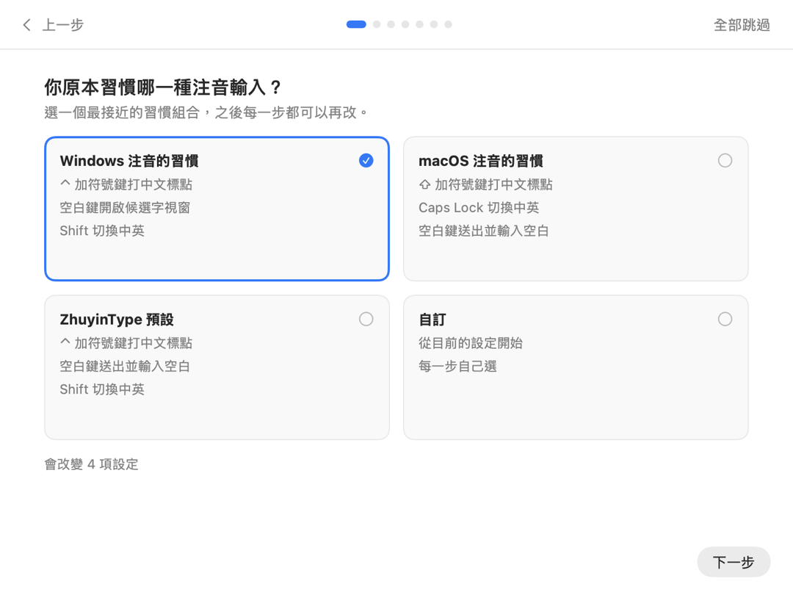
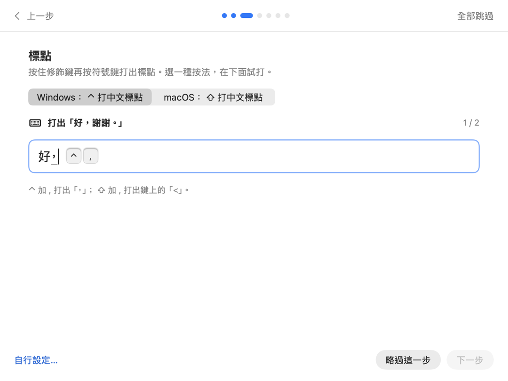
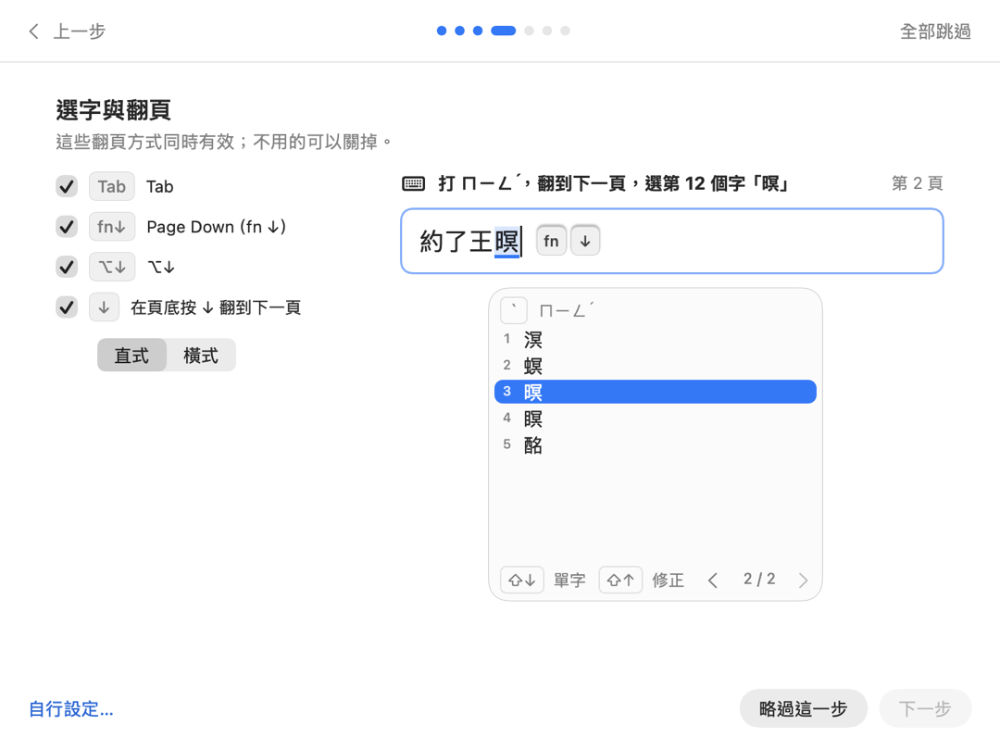
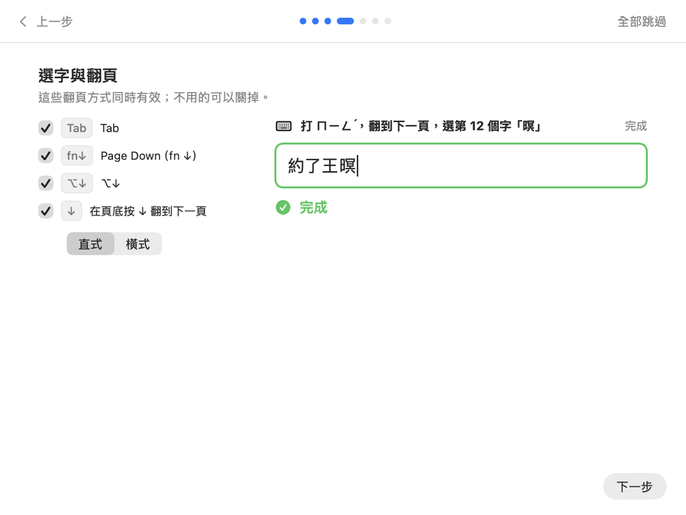
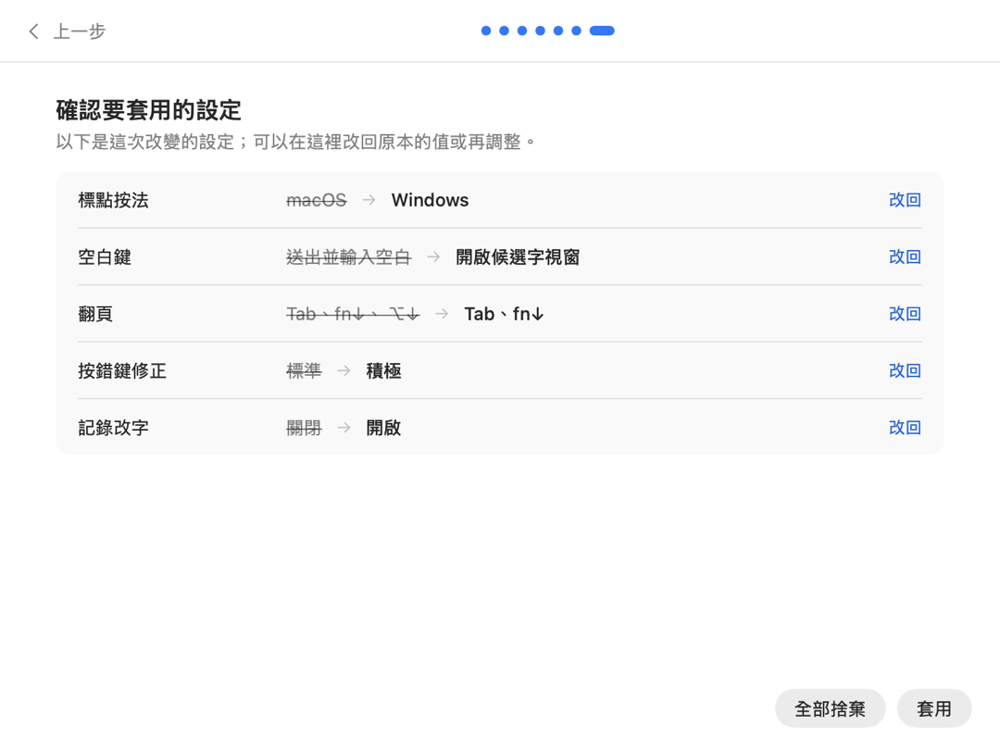
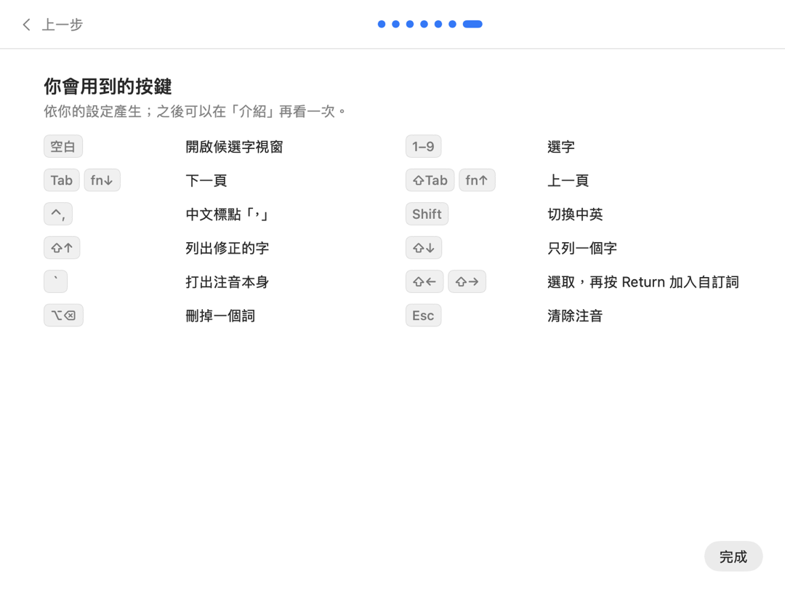

# 設定嚮導（分鏡，待確認）

這份文件是「設定嚮導」的流程與分鏡，確認後才開始實作。圖片是依照設計畫出的靜止畫面（`ZhuyinType --render-ui <資料夾> --only storyboard`），不是可以操作的程式。

## 1. 目的

設定嚮導讓第一次使用的人在幾分鐘內：

- 選好自己原本習慣的打法（標點、空白鍵、中英切換、選字與翻頁）；
- 在嚮導裡實際打幾個字，確認每個選擇的效果；
- 最後看到一份「原本 → 改成」的清單，確認後才套用；
- 留下一頁「你會用到的按鍵」，之後可以在「介紹」再看。

嚮導不另外寫設定的內容。每一步、每個選項、確認頁的清單與按鍵總覽，都從設定的描述（之後的 SETTINGS_API.md）產生，所以新增一個功能時只要寫好它的說明與練習，就會出現在嚮導中。

## 2. 流程

```text
歡迎（快速設定／完整導覽）
  → 習慣組合（Windows 注音的習慣、macOS 注音的習慣、ZhuyinType 預設、自訂）
  → 課程 1 … 課程 N（每一課：說明與小動畫、選擇、練習、完成）
  → 確認要套用的設定（原本 → 改成，可以逐項改回或調整）
  → 你會用到的按鍵
```

- 「快速設定」只走標為「基本」的課程（5 課，約 2 分鐘）；「完整導覽」走全部的課程（11 課）。
- 每一步都有「上一步」「略過這一步」與右上角的「全部跳過」。全部跳過時不改任何設定，直接結束。
- 嚮導中的所有變更都先存在一份暫存的設定裡，練習欄位使用這份暫存設定；按「套用」之前，系統中的輸入法完全照原本的設定運作。

## 3. 什麼時候出現

| 時機 | 內容 |
|---|---|
| 安裝後第一次切換到 ZhuyinType | 從歡迎開始 |
| 更新後加入了新的課程 | 只列出新的課程，例如「這一版新增：翻頁的方式」；可以略過 |
| 「介紹」頁的「開始設定嚮導」 | 從歡迎開始，習慣組合預先選「自訂」（從目前的設定開始） |
| 輸入法選單的「設定嚮導…」 | 同上 |

除此之外不會自己出現。已完成或已略過的版本記在設定中。

## 4. 每一課的組成

每一課依序是：

1. **標題與一句說明**，旁邊是這個功能的小動畫（沿用設定頁的 ⓘ 示範與「視窗與提示」的小動畫）；
2. **選擇**：
   - 互斥的方式是一組分段控制或選項卡，例如標點按法、排列；
   - 可以同時有效的方式是一組勾選，例如翻頁的 Tab、fn ↓、⌥↓、在頁底按 ↓；
   - 「自行設定…」打開同一個按鍵欄位，可以指定其他按鍵；
3. **練習**：一個輸入欄位與一個任務，例如「打出「好，謝謝。」」。切換上面的選擇時，練習欄位立即照新的設定運作，可以直接比較；
4. **完成**：任務達成時欄位外框變成綠色，出現「完成」，「下一步」可以按。任務也可以略過。

## 5. 課程與練習

課程的順序固定；「基本」的課程在快速設定與完整導覽中都會出現，其餘只在完整導覽中出現。完成的判斷都在嚮導內的組字引擎上檢查（見 §8）。

| 課程 | 範圍 | 選擇 | 練習任務 | 完成的判斷 |
|---|---|---|---|---|
| 打字與空白鍵 | 基本 | 空白鍵：送出並輸入空白／輸入空白，不送出／開啟候選字視窗 | 打出「今天天氣很好」 | 欄位的文字是「今天天氣很好」 |
| 標點 | 基本 | 標點按法：Windows（⌃ 打中文標點）／macOS（⇧ 打中文標點） | 打出「好，謝謝。」 | 欄位中有「，」與「。」 |
| 中英切換 | 基本 | 單按 Shift（左右、左、右、不使用）；Caps Lock 打英文 | 切換到英文打「OK」，再切回中文打「好」 | 欄位是「OK好」，且切換過兩次 |
| 選字與翻頁 | 基本 | 排列：直式／橫式；同時有效的翻頁方式：Tab、fn ↓、⌥↓、在頁底按 ↓ | 打 ㄇㄧㄥˊ，翻到下一頁，選第 12 個字「暝」 | 選到「暝」，且翻過頁 |
| 改字 | 基本 | 游標在句中時改：右邊的字／左邊的字 | 把「我在家」改成「我再家」 | 欄位是「我再家」，且是從清單選的 |
| 按錯鍵與修正清單 | 完整 | 按錯鍵修正：關閉／標準／積極；列出修正的字的按鍵 | 照提示故意按錯一個鍵，再用 ⇧↑ 找到正確的字 | 用修正清單選到正確的字 |
| 模糊音 | 完整、可略過 | ㄗ／ㄓ、ㄘ／ㄔ、ㄙ／ㄕ、ㄣ／ㄥ 等勾選 | 以模糊的讀音打出指定的字 | 選到指定的字 |
| 前文 | 完整 | 參考游標前的文字：開／關 | 在已經有「天氣」的欄位接著打出「很好」 | 選字結果用到前文 |
| 加入自訂詞 | 完整 | 選取的按鍵（⇧← ⇧→） | 選取「王小明」，按 Return 加入 | 自訂詞加入暫存資料 |
| 候選字視窗的樣子 | 完整 | 字級、間距、每頁的候選字、選字鍵、位置、外觀、動畫 | 沒有任務，即時預覽 | 按「下一步」 |
| 改字記錄 | 完整、進階 | 記錄改字：開／關；一併記錄游標前的文字 | 沒有任務，說明記錄的內容與存放的位置 | 按「下一步」 |

新功能加入嚮導時，只要在它的設定描述旁寫好：一句說明、小動畫、選擇、一個或幾個練習任務與完成的判斷，並標明「基本」「完整」「可略過」或「進階」。

## 6. 習慣組合

習慣組合是一組選擇的資料，套用時產生一份變更，和確認頁使用同一份清單，所以每一項都看得到、都能改回。名稱描述習慣本身，不使用其他產品的名稱或圖示。

| 設定 | Windows 注音的習慣 | macOS 注音的習慣 | ZhuyinType 預設 |
|---|---|---|---|
| 標點按法 | Windows（⌃ 打中文標點） | macOS（⇧ 打中文標點） | Windows |
| 空白鍵 | 開啟候選字視窗 | 送出並輸入空白 | 送出並輸入空白 |
| 中英切換 | 單按 Shift | Caps Lock（單按 Shift 關閉） | 單按 Shift |
| 排列 | 直式 | 直式 | 直式 |
| 翻頁 | Tab、Page Down（fn ↓）、⌥↓ | Tab、Page Down（fn ↓）、⌥↓ | Tab、Page Down（fn ↓）、⌥↓ |

「自訂」從目前的設定開始，不改任何設定。各組合中的選擇以實際使用兩種系統內建注音輸入法的習慣為準，實作前會再逐項確認（見 §11）。

可以同時有效的方式（例如翻頁的幾個按鍵）在每個組合中都預設開啟，衝突時由按鍵的衝突檢查決定；互斥的方式（例如標點按法、排列）是一個選擇。每個功能有哪些常見的方式，整理在 SETTINGS_API.md 的「方式一覽」中。

## 7. 確認頁與按鍵總覽

- **確認要套用的設定**：列出這次嚮導中改變的每一項設定，一列一項，寫「原本」與「改成」，旁邊有「改回」。點設定名稱可以就地調整（同一個選擇元件）。這份清單由暫存設定與原本設定的差異產生，不另外撰寫。按「套用」才寫入設定；「全部捨棄」不改任何設定並結束嚮導。
- **你會用到的按鍵**：依套用後的設定產生的一頁按鍵表（按鍵圖示與動作），只列有開啟的功能。這一頁之後可以在「介紹」再打開。

## 8. 練習欄位怎麼運作

輸入法無法透過系統的輸入法框架在自己的視窗中打字，所以練習欄位直接在嚮導裡運作：

- 嚮導建立一個自己的組字核心（和輸入法使用同一個 `ControllerCore` 與引擎），文字送到嚮導內的欄位，候選字視窗畫在欄位下方（和「視窗與提示」的預覽是同一個元件）；
- 練習欄位有焦點時，嚮導攔下按鍵（包括 Shift 單按、Caps Lock 與 fn 組合），交給這個核心處理；
- 這個核心使用暫存設定與暫存的使用者資料，練習中打的字、選的字與加入的自訂詞都不寫入你的資料，按「套用」時只套用設定（加入自訂詞的練習會問是否保留那個詞）；
- 系統的安全輸入開啟時（例如另一個視窗正在輸入密碼），練習欄位照常運作，因為它不經過系統的輸入法框架。

做不到的事：練習欄位只能示範 ZhuyinType 自己的行為，不能示範在其他 App 中的情況（例如某個 App 需要把組字顯示在候選字視窗上方）；這些在對應的課程中以文字說明。

## 9. 動態

- **換步驟**：新的一步從右邊滑入 24 pt 並淡入，上一步向左移 12 pt 並較快淡出，共 0.24 秒（ease-out）；按「上一步」時方向相反。
- **完成**：練習欄位外框在 0.2 秒內變成綠色，「完成」的勾號以彈性動畫出現；上方的進度點同時前進一格。
- **選擇改變時**：小動畫與練習欄位立即照新的設定重畫，變化的部分淡入。
- **確認頁**：「改回」的那一列淡出再淡入原本的值；全部改回時清單收合成一句「沒有要改變的設定」。
- 「減少動態效果」開啟時，以上都改成淡入淡出，沒有位移與彈性。嚮導的動態不受「動畫」設定影響（那個設定只管浮動視窗）。

## 10. 分鏡

1. 歡迎：選擇快速設定或完整導覽。

   

2. 習慣組合：選一個最接近的習慣，下方寫出會改變幾項設定。

   

3. 課程「標點」：選擇按法，在下面試打；按鍵即時顯示在游標旁。

   

4. 課程「選字與翻頁」：左邊勾選同時有效的翻頁方式與排列，右邊練習；候選字視窗是真正的元件。

   

5. 完成：欄位外框變成綠色，出現「完成」，可以按「下一步」。

   

6. 確認要套用的設定：原本 → 改成，每一列可以改回。

   

7. 你會用到的按鍵：依最後的設定產生。

   

深色模式的分鏡和以上畫面相同，只是配色不同，沒有放進文件。

## 11. 待確認

1. 流程與課程的順序（§2、§5），以及「基本」課程是否就是這 5 課。
2. 兩個習慣組合的內容（§6），特別是空白鍵與中英切換在兩種系統內建注音中的實際行為。
3. 更新後只列出新課程的做法（§3）。
4. 加入自訂詞的練習結束時，是否詢問要不要保留練習中加入的詞（§8）。
