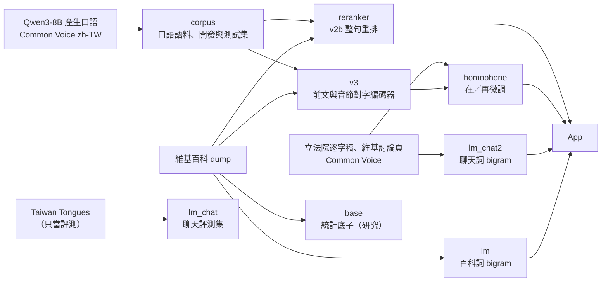

# 訓練

每個子目錄是一個模型或資料的訓練流程，用 `zt train` 執行。

## 用途

- 產生 App 使用的語言模型、神經模型與評測集，以及研究用、沒有採用的模型。
- 程式碼在這裡（AGPL-3.0-only）。產物在資料目錄 `data/build/<名稱>/`，不放進 git；正式版本以 `zt data pack`、`zt data publish` 發布，版本記在 `nlp/data/assets.json`。

## 指令

```sh
zt train list                          # 所有流程與步驟
zt --remote train v3                   # 在 GPU 主機上依序執行所有步驟，已完成的略過
zt --remote train homophone evaluate   # 只執行一個步驟
zt train v3 export --force             # 重跑已完成的步驟
zt --remote --detach train lm          # 在主機背景執行；zt remote logs 看記錄
```

訓練與評測在 GPU 主機上執行；Mac 只做 Core ML 匯出與編譯、延遲量測，以及一次性的一致性檢查。

## 流程



| 流程 | 產物（資料目錄） | App 用到的 | 說明 |
|---|---|---|---|
| `lm` | `lm/` | `lm/` | 維基百科斷詞、modified Kneser-Ney 詞 bigram。建置 App 時以 `zt data compile` 編成 mmap 的 `lm.bin` |
| `corpus` | `corpus/` | — | 口語與維基百科的開發、測試集；Qwen3-8B 產生的口語語料 |
| `lm_chat` | `lm_chat_v1/`、Taiwan Tongues 評測集 | — | 0.3.0 的聊天模型，已停用。Taiwan Tongues 開發、測試集仍用於評測 |
| `lm_chat2` | `lm_chat/` | `lm_chat/` | 真實對話的聊天詞 bigram，0.4.0 起使用（`zt train lm_chat2 ship`） |
| `reranker` | `reranker/` | `reranker/` | 字級 Transformer 語言模型 v2b：整句重排與候選字排序 |
| `v3` | `v3_030/` | — | 0.3.0 的前文編碼器與音節對字編碼器；0.4.0 的模型從這裡繼續訓練 |
| `homophone` | `homophone2/`、`v3_homophone2/` | `v3/` | 在／再等同音字的資料與評測；從 0.3.0 的 v3 繼續微調，以 `v3/` 發布 |
| `base` | `base/` | — | 小麥注音詞庫與期望次數語言模型（研究，0.4.0 未採用） |
| `memory` | `memory/binary/` | — | 記憶體量測與 mmap 二進位的驗證 |

## 共同規則

- 訓練前先固定評測集。訓練語料排除和任何開發集、測試集有連續 8 字相同的句子。
- 每個流程把來源、版本、雜湊與授權記在產物旁（`NOTICE.md`、`provenance.json`、`source_receipts.json` 等），散布模型時一起附上。
- 用開發集選參數，以 `zt eval` 存成 JSON，再用 `zt eval stats` 做成對比較；測試集只在決定後跑一次。結果寫進 `docs/research/log.md`。
- 模型進 App：產物放在 `data/build/<名稱>/`，`zt build app` 會複製到 `Contents/Resources/`。App 的權重來自模型目錄的 `config.json`，以及引擎的 `SyllableScorer.appWeight`、`Engine.chatPrior`；`zhuyin-cli --models` 用同一份程式載入。

## 寫一個新的流程

1. 建立 `nlp/training/<名稱>/`，加上 `__init__.py` 與 `pipeline.py`，定義 `PIPELINE = Pipeline(...)`（見 [pipeline.py](pipeline.py)）。
2. 每個步驟是一個函式 `def step(ctx: Context) -> None`。需要 PyTorch 等套件的工作寫成模組，用 `ctx.python("nlp.training.<名稱>.<模組>", ..., group="train")` 執行。
3. 路徑一律用 `nlp.common.paths` 與 `ctx.out`，不寫死主機或家目錄。
4. README 依 [../CONVENTIONS.md](../CONVENTIONS.md) 的範本；實驗過程與數字寫在 REPORT.md。

## 檔案

| 檔案 | 內容 |
|---|---|
| `pipeline.py` | `Pipeline`、`Step`、`Context`：所有流程共用的介面 |
| `<名稱>/pipeline.py` | 該流程的步驟 |
| `<名稱>/README.md`、`REPORT.md` | 用法；實驗紀錄 |

## 相關文件

- [../CONVENTIONS.md](../CONVENTIONS.md)：程式與文件慣例
- [../../docs/MODEL.md](../../docs/MODEL.md)：各模型的方法與數字
- [../../docs/EVALUATION.md](../../docs/EVALUATION.md)：評測
- [../remote/README.md](../remote/README.md)：在 GPU 主機上執行
