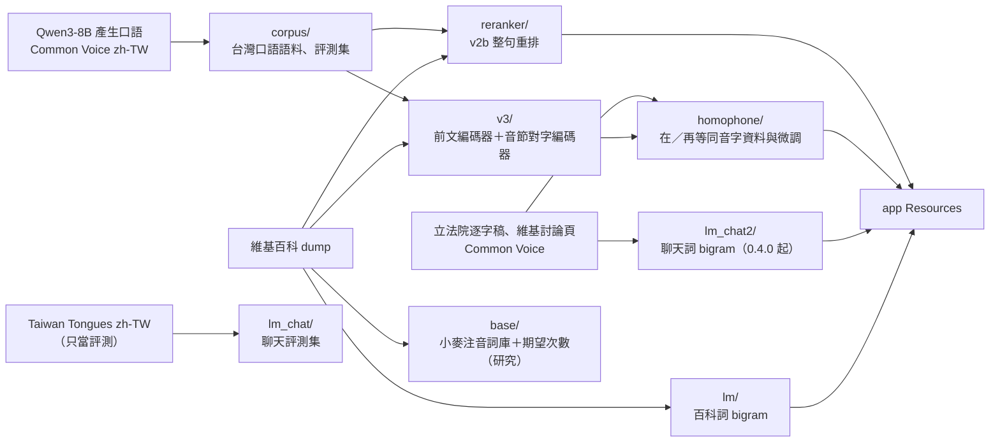

# 訓練

每個子目錄是一條獨立的流程：程式碼在這裡（AGPL-3.0-only），產物在 `data/build/<名稱>/`（不在 git 裡，正式版本以 `nlp/data/assets.py` 發布）。訓練與評測都在遠端 GPU 主機（H100）執行；Mac 只做 Core ML 匯出與編譯（Xcode 的 `coremlcompiler`）、延遲與能耗量測，以及一次性的 Mac／Linux 一致性檢查。評測工具在 [../eval](../eval)，遠端執行器在 [../remote](../remote)。各流程的細節、指令與實驗紀錄在子目錄的 README 與 REPORT。

| 目錄 | 產物（`data/build/`） | 進 app 的檔案 | 說明 |
|---|---|---|---|
| `lm/` | `lm/` | `unigram.tsv`、`bigram.tsv`、`backoff.tsv`（建置時編成 mmap 的 `lm.bin`，`lm/compile_data.py`） | 維基百科斷詞、modified Kneser-Ney 詞 bigram；實驗用三元模型 `lm2` 沒有採用。見 `lm/README.md` |
| `corpus/` | `corpus/` | — | 台灣口語語料（Qwen3-8B 產生 + Common Voice zh-TW）、口語開發與測試集。見 `corpus/README.md` |
| `lm_chat/` | `lm_chat_v1/`、Taiwan Tongues 評測集 | — | 第一版聊天模型（0.3.0，含產生的句子與 Taiwan Tongues，已停用）；Taiwan Tongues 開發、測試集仍用於評測。見 `lm_chat/REPORT.md` |
| `lm_chat2/` | `lm_chat/` | 同 `lm/`，加上 `NOTICE.md`、`attribution.jsonl`、`source-manifest.json` | 真實口語的聊天詞 bigram（立法院逐字稿、維基百科討論頁、Common Voice），0.4.0 起出貨。見 `lm_chat2/REPORT.md` |
| `reranker/` | `reranker/` | `Reranker.mlmodelc`、`RerankerTree.mlmodelc`、`vocab.json`、`config.json` | 字級 Transformer 語言模型（v2b），整句重排（前綴樹計分）與候選字排序。見 `reranker/REPORT_v2.md` |
| `v3/` | `v3_0.3/`（0.3.0 的 v3） | — | 前文編碼器與音節對字編碼器、多音字分類器、打字變體。見 `v3/README.md`、`v3/REPORT.md` |
| `homophone/` | `homophone/`、`v3/`（0.4.0 起） | `ContextEncoder.mlmodelc`、`SyllableEncoder.mlmodelc`、`chars.json`、`syllables.json`、`config.json`、授權與出處 | 同音字（在／再等 26 組）資料集與評測；v3 以可發布的來源微調，0.4.0 起取代原本的 v3。見 `homophone/REPORT.md` |
| `base/` | `base/` | — | 統計底子 A1：小麥注音詞庫、期望次數語言模型（研究，0.4.0 未採用）。見 `base/REPORT.md` |
| `memory/` | — | — | 記憶體量測與 mmap 二進位的驗證 |

## 共同規則

- 訓練前先固定評測集；所有訓練語料排除和評測集有連續 8 字相同的句子（`reranker/prepare.py` 的做法）。
- 每條流程把來源、版本、雜湊與授權記在產物旁（`NOTICE.md`、`provenance.json`、`source_receipts.json` 等），再散布模型時一起附上。
- 評測在 GPU 主機上用固定的 `zhuyin-cli`（`nlp/remote/run.sh`），先用開發集選參數並做成對比較（`nlp/eval/stats.py`），測試集只追蹤、在決定後跑一次。
- 模型進 app：放到 `data/build/<名稱>/`，`clients/macos/scripts/build-app.sh` 會複製到 `Contents/Resources/`；預設權重寫在 `EngineHost`、`ControllerCore` 或模型的 `config.json`。

## 遠端主機

專案在遠端的 `~/zhuyintype`，目錄結構和這裡相同。PyTorch 與 coremltools 在 `.venv-gen`；長時間的工作用 `nohup`，記錄在 `~/zhuyintype/logs/`。連線方式見各子目錄的 README。
