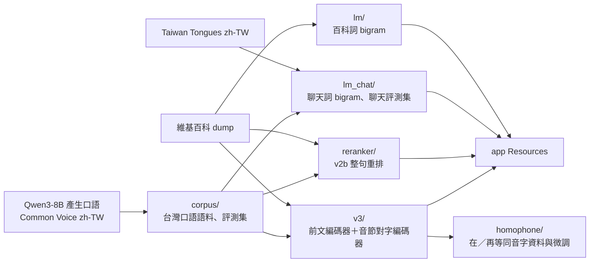

# 訓練

每個子目錄是一條獨立的流程：程式碼在這裡（AGPL-3.0-only），產物在 `data/build/<名稱>/`（不在 git 裡）。大型訓練在遠端 GPU 主機（H100 MIG 3g.47gb）執行，Core ML 匯出與編譯在 Mac 上用 Xcode 的 `coremlcompiler`。各流程的細節、指令與實驗紀錄在子目錄的 README 與 REPORT。

| 目錄 | 產物（`data/build/`） | 進 app 的檔案 | 說明 |
|---|---|---|---|
| `lm/` | `lm/` | `unigram.tsv`、`bigram.tsv`、`backoff.tsv` | 維基百科斷詞、modified Kneser-Ney 詞 bigram；另有實驗用三元模型 `lm2`（沒有採用）與 mmap 二進位格式 `FORMAT.md`（有讀取程式，未出貨）。見 `lm/README.md` |
| `corpus/` | `corpus/` | — | 台灣口語語料（Qwen3-8B 產生 + Common Voice zh-TW）、口語開發與測試集。見 `corpus/README.md` |
| `lm_chat/` | `lm_chat/` | 同 `lm/`，加上授權條款 | 聊天詞 bigram 與 Taiwan Tongues 開發、測試集。見 `lm_chat/README.md`、`lm_chat/REPORT.md` |
| `reranker/` | `reranker/` | `Reranker.mlmodelc`、`vocab.json`、`config.json` | 字級 Transformer 語言模型（v2b），整句重排與候選字排序。見 `reranker/REPORT_v2.md` |
| `v3/` | `v3/` | `ContextEncoder.mlmodelc`、`SyllableEncoder.mlmodelc`、`chars.json`、`syllables.json`、`config.json` | 前文編碼器與音節對字編碼器、多音字分類器、打字變體。見 `v3/README.md`、`v3/REPORT.md` |
| `homophone/` | `homophone/`、`v3_homophone/`、`reranker_homophone/` | 驗收後取代 `v3/` 或 `reranker/` | 同音字（在／再等）資料集、評測與微調（進行中） |
| `eval/` | — | — | 評測工具，見 [docs/EVALUATION.md](../docs/EVALUATION.md) |

## 共同規則

- 訓練前先固定評測集；所有訓練語料排除和評測集有連續 8 字相同的句子（`reranker/prepare.py` 的做法）。
- 每條流程把來源、版本、雜湊與授權記在產物旁（`NOTICE.md`、`provenance.json`、`source_receipts.json` 等），再散布模型時一起附上。
- 評測在 Mac 上用固定的 `zhuyin-cli`，先用開發集選參數，測試集只在決定採用時跑一次。
- 模型進 app：放到 `data/build/<名稱>/`，`clients/macos/scripts/build-app.sh` 會複製到 `Contents/Resources/`；預設權重寫在 `EngineHost`、`ControllerCore` 或模型的 `config.json`。

## 遠端主機

專案在遠端的 `~/zhuyintype`，目錄結構和這裡相同。PyTorch 與 coremltools 在 `.venv-gen`；長時間的工作用 `nohup`，記錄在 `~/zhuyintype/logs/`。連線方式見各子目錄的 README。
